# Database design

Target: **MySQL 8.4** with `utf8mb4`. M16 verified a fresh MySQL 8.4 migration run and the full test suite (221 tests / 20,420 assertions); MariaDB 12.3 remains the local development service. Schema changes are applied only through Doctrine migrations.

## Migration groups

| Version | Group | Notes |
|---|---|---|
| `Version20261112110620` | Identity, access, settings | Users, roles, permissions, settings, redirects, activity log, Messenger table |
| `Version20261112110744` | Content | Media, taxonomy, articles, revisions, pages, menus, advertisements, user avatar relation |
| `Version20261112110829` | Engagement and email | Comments, likes, bookmarks, views, daily stats, subscribers, campaigns |
| `Version20261112114159` | Account recovery | `reset_password_request` selector/token pairs with a cascading user relation |
| `Version20261112130000` | Search | FULLTEXT index `ft_article_search` on article title/excerpt/content |
| `Version20261112174153` | Redirects | Shorten `redirect.source_path` to 512 chars so its unique index fits MySQL 8/InnoDB limits |
| `Version20261112185703` | Monetization | Ad destination/paragraph targeting and article sponsored/affiliate/premium flags |
| `Version20261113113808` | Media cleanup remediation | Retained deletion tombstone cleanup-completion timestamp |
| `Version20261114132536` | Newsletter delivery remediation | Unique campaign/recipient ledger, nullable subscriber relation, attempt and acceptance timestamps |

The original M3–M16 migrations were generated from attribute mapping and historically verified up, down and up again on a fresh empty database. `redirect.source_path` is created as `VARCHAR(512)` from the initial migration so its unique index fits MySQL 8/InnoDB utf8mb4 limits (the later redirect migration remains a no-op for fresh installs).

The newsletter remediation migration was generated against the reset test database, then reversed/reapplied on the empty `fieldnotes_test` database. Its mapping matches; the only subsequent schema diff is the existing unmapped `messenger_messages` table, which must **not** be dropped. An additional isolated database could not be created with this account's grants. The development database was not changed: it contains unavailable `Version20261113124023` and an incompatible older ledger table. Reconcile that history/schema with backups before upgrading it; do not blindly apply the create-table migration. See [`newsletter.md`](newsletter.md).

## Conventions

- Auto-increment integer identifiers; all date columns are `DATETIME`/`DATE` immutable in PHP.
- `Gedmo\Timestampable` owns `created_at` and `updated_at` on every entity.
- `Gedmo\SoftDeleteable` applies to `app_user`, `article`, `comment`, `page` and `media`; queries exclude deleted rows through the enabled Doctrine filter.
- `Gedmo\Sluggable` generates unique URL slugs for users, articles, categories, tags and pages. Database `UNIQUE` indexes remain the final guarantee.
- `Gedmo\Tree(type: nested)` manages category hierarchy with `lft`, `rgt`, `lvl` and `root`, scoped per root.
- Foreign keys use explicit policies: content owned by an article cascades, optional authorship/media references become `NULL`, and required authorship restricts deletion.
- JSON columns are restricted to flexible payloads: media variants, settings values, activity context, campaign statistics.
- Permissions are strings (`article.publish`) grouped into roles; roles are data, not hardcoded class constants.

## Entity relationships

```mermaid
erDiagram
    USER ||--o{ USER_ROLE : has
    ROLE ||--o{ USER_ROLE : assigned
    ROLE ||--o{ ROLE_PERMISSION : grants
    PERMISSION ||--o{ ROLE_PERMISSION : included
    USER }o--o| MEDIA : avatar
    USER ||--o{ ARTICLE : authors
    USER ||--o{ ARTICLE_REVISION : creates
    USER ||--o{ COMMENT : writes
    USER ||--o{ ARTICLE_LIKE : likes
    USER ||--o{ ARTICLE_BOOKMARK : saves
    USER ||--o{ ACTIVITY_LOG : performs
    USER ||--o{ RESET_PASSWORD_REQUEST : requests
    MEDIA ||--o{ ARTICLE : featured_image
    MEDIA ||--o{ CATEGORY : image
    MEDIA ||--o{ ADVERTISEMENT : creative
    ARTICLE ||--o{ ARTICLE_CATEGORY : categorized
    CATEGORY ||--o{ ARTICLE_CATEGORY : contains
    ARTICLE ||--o{ ARTICLE_TAG : tagged
    TAG ||--o{ ARTICLE_TAG : labels
    ARTICLE ||--o{ ARTICLE_REVISION : revisions
    ARTICLE ||--o{ COMMENT : receives
    ARTICLE ||--o{ ARTICLE_LIKE : receives
    ARTICLE ||--o{ ARTICLE_BOOKMARK : receives
    ARTICLE ||--o{ ARTICLE_VIEW : views
    ARTICLE ||--o{ ARTICLE_DAILY_STAT : rollup
    COMMENT ||--o{ COMMENT : replies
    CATEGORY ||--o{ CATEGORY : children
    MENU ||--o{ MENU_ITEM : contains
    MENU_ITEM ||--o{ MENU_ITEM : children
    NEWSLETTER_CAMPAIGN ||--o{ NEWSLETTER_DELIVERY : audience
    NEWSLETTER_SUBSCRIBER |o--o{ NEWSLETTER_DELIVERY : recipient

    USER {
        int id PK
        string email UK
        string password
        string display_name
        string slug UK
        string job_title
        text bio
        bool is_active
        bool is_verified
        datetime last_login_at
        string totp_secret
        int avatar_id FK
        datetime deleted_at
    }
    ROLE {
        int id PK
        string name UK
        string code UK
        text description
        bool is_system
    }
    PERMISSION {
        int id PK
        string code UK
        string label
        string permission_group
    }
    ARTICLE {
        int id PK
        string title
        string subtitle
        string slug UK
        text excerpt
        longtext content
        string status
        string visibility
        datetime published_at
        datetime scheduled_at
        int author_id FK
        int featured_image_id FK
        bool allow_comments
        int reading_time
        int view_count
        int like_count
        datetime deleted_at
    }
    ARTICLE_REVISION {
        int id PK
        int article_id FK
        string title
        longtext content
        int created_by_id FK
        bool is_autosave
    }
    CATEGORY {
        int id PK
        string name
        string slug UK
        text description
        int image_id FK
        int parent_id FK
        int lft
        int rgt
        int lvl
        int root
    }
    TAG {
        int id PK
        string name
        string slug UK
        text description
    }
    COMMENT {
        int id PK
        int article_id FK
        int parent_id FK
        int user_id FK
        string guest_name
        string guest_email
        text content
        string status
        string ip_hash
        int report_count
        datetime deleted_at
    }
    ARTICLE_VIEW {
        int id PK
        int article_id FK
        datetime viewed_at
        string visitor_hash
        string referrer
    }
    ARTICLE_DAILY_STAT {
        int id PK
        int article_id FK
        date stat_day
        int views
    }
    MEDIA {
        int id PK
        string filename
        string original_name
        string mime_type
        int size
        int width
        int height
        string alt
        string caption
        string storage_key UK
        json variants
        int uploaded_by_id FK
        datetime deleted_at
    }
    PAGE {
        int id PK
        string title
        string slug UK
        longtext content
        string status
        datetime published_at
        int author_id FK
        datetime deleted_at
    }
    MENU {
        int id PK
        string name
        string location UK
    }
    MENU_ITEM {
        int id PK
        int menu_id FK
        string label
        string type
        string target
        int parent_id FK
        int position
    }
    NEWSLETTER_SUBSCRIBER {
        int id PK
        string email UK
        string status
        string token UK
        datetime confirmed_at
        datetime unsubscribed_at
    }
    NEWSLETTER_CAMPAIGN {
        int id PK
        string subject
        longtext html
        string status
        datetime scheduled_at
        datetime sent_at
        json stats
    }
    NEWSLETTER_DELIVERY {
        int id PK
        int campaign_id FK
        int subscriber_id FK "nullable; SET NULL on deletion"
        int recipient_id "retained subscriber identity"
        string status
        datetime attempted_at
        datetime sent_at
    }
    ADVERTISEMENT {
        int id PK
        string name
        string placement
        string type
        longtext content
        int image_id FK
        datetime starts_at
        datetime ends_at
        bool is_active
        int priority
    }
    SETTING {
        int id PK
        string setting_key UK
        json value
        string setting_group
        bool is_sensitive
    }
    RESET_PASSWORD_REQUEST {
        int id PK
        int user_id FK
        string selector
        string hashed_token
        datetime requested_at
        datetime expires_at
    }
    REDIRECT {
        int id PK
        string source_path UK
        string target_url
        smallint status_code
        int hits
    }
    ACTIVITY_LOG {
        int id PK
        int user_id FK
        string action
        string subject_type
        int subject_id
        json context
        string ip
        datetime created_at
    }
```

## Index and constraint highlights

- `article(status, published_at)` and `article(author_id)` support public feeds and author archives.
- `article_revision(article_id, created_at)` supports revision history and autosave pruning.
- `comment(article_id, status, created_at)` supports public threads and moderation queues.
- `article_view(article_id, viewed_at)` and `article_view(viewed_at)` support de-duplication, rollups and retention pruning.
- `article_daily_stat UNIQUE(article_id, stat_day)` prevents duplicate rollup rows.
- `article_like UNIQUE(article_id, user_id)` and `article_bookmark UNIQUE(article_id, user_id)` make duplicate engagement impossible.
- `newsletter_delivery UNIQUE(campaign_id, recipient_id)` prevents duplicate audience rows; `(campaign_id, status, recipient_id)` supports bounded delivery/recovery reads. Ledger rows cascade on campaign deletion but survive subscriber deletion with a null subscriber relation.
- `media.storage_key`, `menu.location`, `setting.setting_key`, `redirect.source_path`, subscriber `email`/`token` and all slugs are unique.
- `activity_log(created_at)` supports the audit feed.
- `reset_password_request(user_id)` supports lookup and cascades when a user is removed.

## Fixtures and factories

`App\DataFixtures\DemoFixtures` recreates the M1 contract: 6 users, 5 roles, 31 permissions, 6 media records, 8 categories (two nested), 25 tags, 36 articles (30 published, 6 non-public), 5 moderated comments, 5 pages, 2 menus with 6 items, 3 advertisements, 18 subscribers, 3 campaigns, 5 activity records and 1 redirect.

Foundry factories under `tests/Factory` provide isolated records for repository and functional tests.
